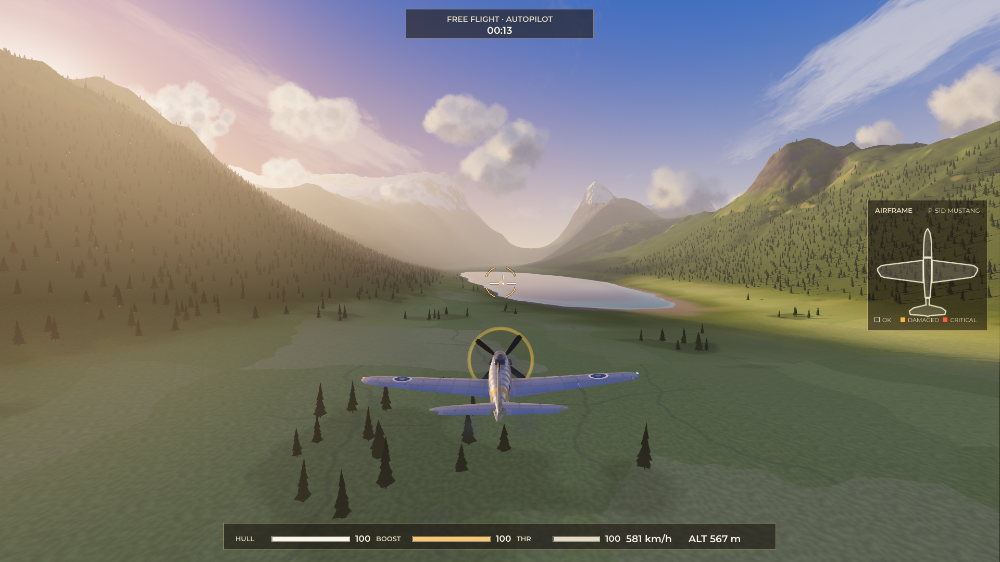
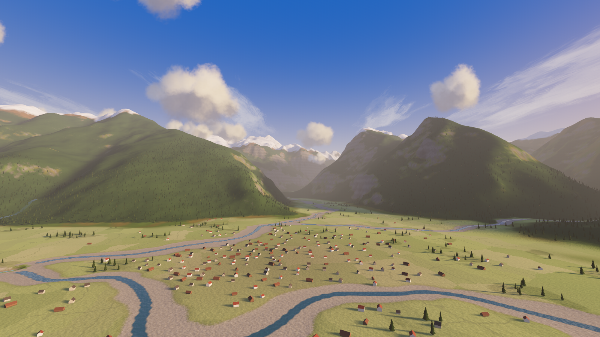
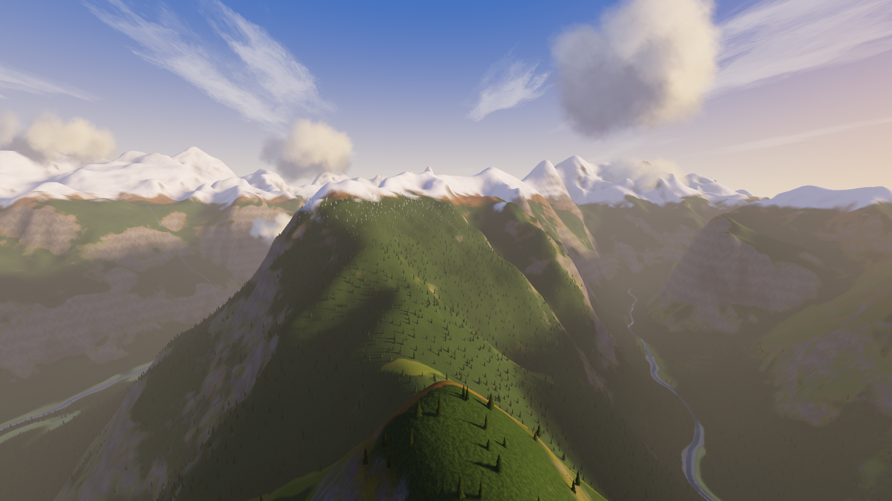

# Airflight

A 1940s arcade dogfight game for desktop, built with **Godot 4.5.1**, typed GDScript
and **Blender 5.2**. Pick a Spitfire, a Mustang or a Thunderbolt and fight AI
fighters low through an Alpine valley at golden hour: snow peaks, forested slopes,
a mountain lake, cumulus clouds and sun glare.




**Status: milestones 1-4 of 5.** Three flyable aircraft, a selection screen,
guns, damage, two AI opponents, and online matches for 2 to 4 players. Online
play is tested on one machine. A match between two homes, and Windows against
Linux, are still to do, as are rockets and practice targets (see
[Roadmap](#roadmap)).

## The aircraft

| | Spitfire Mk IX | P-51D Mustang | P-47D Thunderbolt |
|---|---|---|---|
| Class | Light | Medium | Heavy |
| Top speed | 619 km/h (boost 738) | 583 km/h (boost 691) | 540 km/h (boost 641) |
| Agility | Best | Good | Slow to roll and pull |
| Firepower | 96 damage/s | 130 damage/s | 196 damage/s |
| Hull | 80 | 100 | 135 (and a bigger target) |
| Gunsight zoom | up to 3× | up to 4× | up to 6× |
| Unbroken fire before the guns overheat | 8 s | 7 s | 6 s |
| Engine sound | Smooth, quick Merlin growl | Deeper Merlin growl, a shade rougher | Low rolling radial note |
| Guns | Quick, dull rattle | Heavy .50 cal punch | Eight-gun thump |

Real dimensions; balance is tuned for play, not history. The selection screen
appears before each sortie (and from the pause menu); hovering a card plays that
aircraft's engine.

**Moving wings.** The ailerons, elevators and rudder follow the stick with more
travel than the real aircraft used, and a dark slot opens at each hinge, so you
can read them from the chase camera. The flaps come down by themselves: fully
when the aircraft is slow (below twice its stall speed), and 60% of the way as
combat flaps in a firm turn, judged against the hardest pull that aircraft can
make, so they show alike on all three. They drop less above 80% of the aircraft's
top speed and stay up at boost speed. The Mustang and Thunderbolt have hinged
flaps on the trailing edge (40°) that slide back as they drop, opening a dark
slot; the Spitfire has split flaps that drop from under the wing (60°). The wings
bend upward with the load and spring back, overshooting slightly,
when you ease off, and shudder near the stall. The Spitfire's thin wings bend most,
the Thunderbolt's stiff ones least. All of this is visual only: it does not change
how the aircraft flies. It is worked out from each aircraft's speed and motion, so
other players' aircraft online show it too, with nothing extra sent.

Each aircraft has five damage zones: engine, body, left wing, right wing and tail.
A damaged engine loses power, holed wings roll slowly, a shot-up tail pitches and
yaws slowly, and a badly hit aircraft trails smoke and then fire. The airframe
panel on the right shows where you have been hit, with a dark hole for each round
that struck. The opponent in your sights gets the same panel on the left: its
type, range, damaged zones, bullet holes, exact hull percentage and worst damage.
It fades in when you aim at or hit that aircraft, stays two seconds after you look
away, then fades out; aiming at another opponent swaps it over. Online, holes from
other players' rounds are placed at random inside the zone that was hit, because
only the zone is sent over the network.

**Guns and heat.** Firing heats the guns; the GUNS bar in the status strip and
an arc under the gun cross show how hot they are. For the first half of the
time in the table they fire at the full rate. After that the rate drops round
by round to under a third, the rounds scatter more, and at the limit the guns
stop ("GUNS OVERHEATED"). They cool only while silent: 10 seconds from red-hot
to cold, and overheated guns come back after 4 seconds, at the tick on the
bar. One-second bursts with short pauses never overheat. Hot guns smoke at the
muzzles. Opponents' guns follow the same rule.

Your own tracers glow gold, a team-mate's pale and everyone else's red. Each
round leaves a thin wisp of smoke, and a hostile round passing close is heard.
Hits flash and throw sparks; misses raise dust on the ground or a splash on the
lake. Strike effects and other aircraft are drawn larger than life at range
(an aircraft about twice its size at 2 km, never more than 2.5 times) so both
can be read from far away; hits are judged on the true size. Opponents carry a
bracket with name and range and no aiming mark: lead a turning target by eye
and correct from the tracers.

**Energy.** Height and speed trade against each other. A dive runs the
aircraft past its level top speed; a climb costs speed, and the steeper the
climb the less the labouring engine can add (a fifth of its thrust straight
up), so nothing hangs on its propeller: pointed at the sky from top speed an
aircraft is out of flying speed in 7 to 10 seconds, even on boost. Then it
stalls: the HUD warns, the nose falls below the horizon and the controls come
back as the speed does. About 30° is a climb that can be held at full throttle.

**Brake.** Holding Space chops the engine to idle and drops the flaps fully into
the airflow, a little more than doubling the drag. From top speed it sheds 210
to 255 km/h in 4 seconds (throttling back: about 100), enough to make a pursuer overshoot or to tighten a turn,
and it holds a dive to a modest speed. The throttle setting is kept and comes
back when the key is released; the speed has to be earned again. Held long enough
in level flight it takes the aircraft into the stall. The AI pilots do not use it.

**Engines.** Each engine is two loops, low revs and high revs, crossfaded as
the RPM rises, so the note climbs without the sound turning thin. They are
tuned against recordings of the real aircraft (measured, not sampled): the two
Merlins fire 210 to 240 times a second at full throttle and are heard as a
growl at half that, one cylinder bank at a time; the Thunderbolt's radial is
a deep note at a third of its firing rate with a slow roll in it. The loops
are clean on purpose: the engine's own harmonics carry the sound, with no
distortion, a trace of exhaust breath, peaks kept under full scale, and nearly
all the energy below 600 Hz. They are imported uncompressed, and a limiter on
the output keeps gunfire over a full-throttle engine from clipping. The revs
follow the flying, not only the throttle:
they sag by up to a quarter and the engine shudders and grows louder as it
labours up a steep climb, dip in a hard pull, and run up in a dive. Other
aircraft rise in pitch as they come at you and drop as they pass.

Opponents fly the same flight model as you. They patrol, attack in passes, fire
short bursts, break away when hit and avoid the mountains. Each one that goes
down returns a few seconds later as the next aircraft type. Their rounds do half
damage so beginners last longer.

## Play

Download the packages from the
[latest release](https://github.com/video-games-by-ai/angels-one-five/releases/latest).
No installer is needed on a computer; both desktop builds need a Vulkan-capable
GPU with a current driver.

**Windows:** unzip `airflight-windows.zip` and double-click `Airflight.exe`.
It requires 64-bit Windows 10/11. The Windows build is exported and its data
pack was smoke-tested under Linux, but it **has not yet been run on a Windows PC**.

**Linux:** unpack `airflight-linux.tar.gz` and run `./airflight.x86_64`.

**Android (experimental):** download `airflight-android.apk` on the phone and
tap it; see [Android](#android-experimental). It needs a 64-bit ARM phone.

**Linux, from a checkout:**

```sh
./run.sh
```

This runs `build/airflight-linux/airflight.x86_64` (standalone, no editor
needed). If that build is missing, it runs the project with Godot 4.5.1.

**From source (any OS):** install [Godot 4.5.1](https://godotengine.org/download/archive/4.5.1-stable/),
open `game/project.godot` and press F5.

### Controls

| Input | Action |
|---|---|
| Mouse | Move the aim circle; the aircraft banks and turns toward it |
| Left click | Fire the guns |
| Shift | Boost (limited, regenerating reserve) |
| W / S | Throttle up / down |
| Space | Brake: hold to slow down (engine to idle, flaps fully down) |
| A / D | Manual roll |
| Q / E | Rudder |
| C | Re-centre the aim on the nose |
| Z | Zoom in for long shots; press again to zoom back out |
| Mouse wheel | Zoom in / out by steps, up to the aircraft's gunsight limit (Z returns to the level used last) |
| Esc | Pause menu, settings and Change aircraft (on the selection screen: settings) |
| Enter | Online: open the chat line; Enter sends, Esc cancels |
| 1 / 2 / 3, ← / →, Enter | Choose and fly an aircraft on the selection screen |
| M | Change map on the selection screen |
| F11 | Fullscreen |
| F3 | Frame-rate readout |
| F4 | Snow showers on / off (weather test) |

The small white cross shows where the nose and guns point; the amber circle is
where you are steering. Opponents are marked with orange brackets, their range
and hull; within 1 km a small orange ring shows where to aim so the rounds meet
them. Off-screen opponents get an arrow at the screen edge. If you leave the mouse alone, assisted levelling eases the aim back to
the horizon. The aircraft is lost on contact with the ground, the lake or
treetops, and respawns after three seconds.

### Android (experimental)

The game builds for Android phones with the "Android" export preset
(64-bit ARM, Godot's Mobile renderer). Releases carry it as
`airflight-android.apk`: download it on the phone, tap it and allow the
install from that app when Android asks.

- **Flying:** the left thumb steers with a stick that appears where it lands;
  the right thumb has FIRE, BOOST, BRAKE, ZOOM and pause. Tap an aircraft on the
  selection screen to fly it. Throttle, roll, rudder, rockets and chat have no
  touch controls yet.
- **Device test:** the selection screen has a **Device test** button. It flies
  twelve short autopilot flights, each with one more graphics feature switched
  off, restarts the game between them and ends with a report. The game also
  keeps a log on every start. Both are in
  `Android/data/io.github.video_games_by_ai.airflight/files/Documents/` on the
  phone, readable from a computer over USB (`game/scripts/core/device_diag.gd`).
- **Graphics:** phones start on Low quality (a Pixel 6 reaches about 20 frames
  a second on High). The Mobile renderer never uses MSAA, at any quality: with
  MSAA it cannot give shaders the scene depth, and the snow showers and clouds
  were drawn as solid white over everything. FXAA smooths edges instead.
- **Known problems (Pixel 6):** flickering square artefacts and a crash after
  about 30 seconds were reported with an early test build; neither has been seen
  in the game's own log since, and neither is diagnosed. Menus are sized for a
  monitor and are small on a phone.

Build: install Godot's Android export templates; `tools/build_release.sh`
then writes `build/airflight-android.apk`. It signs with the key named by
`GODOT_ANDROID_KEYSTORE_RELEASE_PATH`, `_USER` and `_PASSWORD`, or with Godot's
debug key on the build machine when they are not set. Android installs an
update only over a build signed with the same key, so releases have to keep
coming from one key.

### Maps

The selection screen has a **Map** button (or press M). The choice is remembered.

- **Alpine Valley** (default): a fictional glacial valley with a lake, peaks to 4000 m.
- **Plav & Gusinje**: the real valley in the Prokletije mountains of Montenegro,
  24 km across, built from surveyed elevation data. Plav lake has its real outline
  and lies at 0 m; the Ljuča river winds into it from Gusinje and the Lim leaves
  it northward; the Grnčar, Grebaje and Ropojana valleys branch off toward the
  high peaks in the south. Heights are measured from the lake (really at 902 m)
  and stretched 1.54 times so the mountains look bigger: the highest summit on
  the map, the Kolata massif on the Albanian border, stands 2450 m above the
  lake, and snow lies from 1500 m. Towns and villages are in their real places.





### Settings (Esc, or Settings on the selection screen)

Mouse sensitivity, inverted vertical mouse, assisted levelling, camera shake,
master volume, engine & wind volume, guns & effects volume, graphics quality
(Low / Medium / High) and fullscreen. Changes apply at once and are saved, with
the last aircraft and map, to Godot's user folder (`settings.cfg`), so they are
kept for the next launch.

**Weather test:** the day is clear, with a few local snow showers: sunlit veils
of falling snow with low visibility inside and a light dusting of fresh snow on
the ground and trees beneath them. One sits in the valley ahead of the start.
F4 or the "Snow showers" setting turns them off and on for comparison
(`--weather=0|1` on the command line).

### Online play

Free-for-all for 2 to 4 players; the first to 5 kills wins. One player hosts,
and only the host opens a port. Everyone else just pastes an invite and installs
nothing.

1. **Host:** choose an aircraft, press **Host match**, then:
   - forward **UDP 24555** to your computer in your router once, or tick
     **Open port automatically (UPnP)** (off unless you choose it; the port is
     closed again when you stop hosting);
   - allow Airflight through your computer's firewall when it asks;
   - press **Detect** (or type your public address or a dynamic DNS name);
   - press **Copy invite** and send it to your friends in a private chat.
2. **Friends:** choose an aircraft, press **Join match**, then **Paste**. The
   invite is checked at once: the game shows the host's address, or says what
   is wrong (for example how many of its characters did not arrive), and
   **Join** works only for a sound invite. **Clear** empties the field. Line
   breaks and spaces added by chat or mail programs do not matter.
3. The host sees who is in (and can **Kick**), and presses **Start match**. After
   the result everyone is back in the lobby; Start match again is the rematch.

The invite works like a password. The connection is encrypted, a joiner checks
it has reached the real host, and the host lets in only games holding the
invite's secret. Five failed attempts from one address block it for ten minutes.
If your provider shares one address between customers (carrier-grade NAT), port
forwarding cannot work: the lobby warns about it, and someone else should host.
Esc during an online match opens the settings without pausing the others; its
middle button ends the match (host) or leaves it.

**Chat**, in the lobby and in flight: press **Enter**, type, **Enter** sends
(**Esc** cancels). Lines appear small at the bottom left for everyone, newest at
the bottom, at most five; each fades after 8 seconds and the recent ones come
back while you type. While the chat line is open the keys write text, and the
mouse still steers and fires. A message is up to 80 characters. Sketches:
[docs/sketches/chat-overview.svg](docs/sketches/chat-overview.svg),
[docs/sketches/chat-states.svg](docs/sketches/chat-states.svg).

If nobody can open a port, a small rented server can host with no pilot of its
own: `./Airflight.x86_64 --headless -- --server --address=SERVER_IP` prints the
invite and starts a match whenever two players are in. Design, security and test
results: [docs/multiplayer-design.md](docs/multiplayer-design.md).

## Performance

Measured with the built-in benchmark: 30 s of scripted low flight down the
valley, 1920×1080, vsync off, release export.

| Preset | Average FPS | 1% low FPS |
|---|---|---|
| High | 121.9 | 93.3 |
| Medium | 148.5 | 116.0 |
| Low | 318.0 | 212.3 |

These figures were measured for milestone 1. With combat added, a back-to-back
run of the same High benchmark against the milestone-1 code measured 117.3 vs
116.1 FPS, so free flight did not get slower. A fight with two opponents costs
more (about 100-150 FPS on High in the AI demo); that has not been benchmarked
on its own yet.

Test machine: Fedora Linux 44, AMD Ryzen 7 3700X (8 cores), NVIDIA GeForce RTX
2070 SUPER 8 GB (driver 615.71), 46 GB RAM, Vulkan, Godot 4.5.1. Raw results are
in `docs/benchmarks/`. To reproduce:

```sh
./run.sh --resolution 1920x1080 --disable-vsync -- --benchmark=30 --quality=2
```

The presets differ in terrain detail distance, tree draw distance and shadows,
shadow distance, screen-space reflections and ambient occlusion, MSAA, cloud
count and render scale (Low renders at 80% with FSR upscaling).

## How it is built

Everything is original or freely licensed; nothing is downloaded at build time
(the elevation survey for the second map is kept in the repository).

| Part | Source | Output |
|---|---|---|
| Alpine Valley heightmap, shadows, forest mask, 158k tree positions | `tools/generate_terrain.py` (Python + NumPy/SciPy) | `game/assets/terrain/alpine_*` |
| Plav & Gusinje: the same from surveyed elevations, plus gravel beds, brooks, reed beds, settlements and house positions | `source-assets/plav_dem.npz` → `tools/generate_plav.py` | `game/assets/terrain/plav_*`, `docs/plav_preview.png`, `docs/plav_layers.png` |
| Spitfire Mk IX, P-51D Mustang, P-47D Thunderbolt (moving prop, ailerons, flaps, elevators, rudder, wings that bend; fictional markings) | `tools/build_aircraft.py` → `source-assets/{spitfire,mustang,thunderbolt}.blend` | `game/assets/models/*.glb` |
| Conifers | `tools/build_trees.py` → `source-assets/trees.blend` | `game/assets/models/trees.glb` |
| Three engines (two loops each), three guns (three takes each), gun jam, near miss, hits, explosion, wind (synthesised) | `tools/generate_audio.py` | `game/assets/audio/` |
| Packages for Linux, Windows and Android | `tools/build_release.sh` | `build/` |
| GitHub release with the three packages | `tools/publish_release.sh` | [Releases](https://github.com/video-games-by-ai/angels-one-five/releases) |

Rebuild steps:

```sh
python3 tools/generate_terrain.py
python3 tools/generate_plav.py
blender --background --factory-startup --python tools/build_aircraft.py
blender --background --factory-startup --python tools/build_trees.py
python3 tools/generate_audio.py
tools/build_release.sh
```

To publish a release, bump `config/version` in `game/project.godot` (and the
versions in `game/export_presets.cfg`), commit and push, then run
`tools/publish_release.sh`. It rebuilds the packages from that commit, tags it `vX.Y.Z` and uploads them (`--dry-run` builds without publishing).

**Plav & Gusinje is built in layers** (see the top of `tools/generate_plav.py`),
so each can be refined on its own. `docs/plav_layers.png` shows them side by side.

1. **Elevation:** the SRTM survey at about 28 m per pixel, kept in
   `source-assets/plav_dem.npz`. It was fetched once with
   `tools/fetch_plav_dem.py` (20 tiles, 2.7 MB, from the open Terrain Tiles
   dataset; credits in `licenses/TERRAIN-DATA.txt`).
2. **Lake:** the level water surface found in the survey.
3. **Drainage:** where water gathers on the surveyed ground. The Ljuča below
   Gusinje and the Lim carry real water; every other stream is a painted brook,
   with a gravel bed once its catchment is large enough.
4. **Settlements:** traced from a satellite screenshot and tied to the survey by
   the lake.
5. **Rules:** forest (altitude, slope, which way a slope faces), reed beds, hay
   meadows and snow.

Three things are not as surveyed. The game has one level water surface, so
ground within a few tens of metres above the lake is levelled out (the real
floor climbs 20 m from the lake to Gusinje) and ground below the lake, down the
Lim, is raised to it. The survey smooths sharp summits, so the needle peaks are
lower and rounder than in life. Detail finer than 28 m is added noise.

A map is a set of files `game/assets/terrain/<id>_*` plus an entry in
`TerrainData.MAPS`; its `meta.json` carries the lake level, sun, start position,
route for the AI, snow shower sites and the look (snow line, colours).

The release script also runs the headless flight tests in
`game/tests/test_flight.gd`. They cover terrain sampling, turning, climbing,
the cost of steep climbs and the stall, levelling, boost, collision, class balance, mouse/invert handling, fire rates,
gun heat (slowing, stopping, cooling), round scatter, tracer colours, near misses,
the engine sound mix, revs that follow climbs and dives, unclipped and
uncompressed engine loops, the output limiter, fly-by pitch, the larger drawing of distant aircraft,
hits and misses, time to kill per aircraft, damage zones and their effects, the
slowdown of burning aircraft, the trail stages, flaps and wing bending, health dots, bullet-hole placement, the target panel's fading, radar placement, and
AI pilots hunting for three minutes without crashing. The Plav & Gusinje map is
checked too: lake level, summit height and place, the route, the autopilot flying
it end to end and AI pilots hunting over it without crashing.

`game/tests/test_net.gd` checks online play: invites and every message type
(including truncated, damaged and random packets), the host's rules for motion
reports, hits, kills, respawns and the result, remote aircraft smoothing under
packet loss, and real loopback connections for each security rule (wrong
certificate, wrong or missing secret, blocking, unencrypted clients, junk
packets, version mismatch, Kick, New invite) and chat (relay, sender stamping,
flood limit, fading and wrapping, typing without losing the mouse).
`tools/net_smoke.sh` plays a whole match between two headless copies of the game
flown by the AI, each sending a chat line (`AIRFLIGHT_SERVER=1` for a dedicated
server and two players). `game/tests/render_chat.gd` draws the chat over game
screenshots for checking its look, and `game/tests/render_wings.gd` draws each
aircraft with its flaps up and down and its wings straight and bent.

For an unattended demo, `--ai-player` lets an AI fly and fight for you, and
`--aircraft=0|1|2` skips the selection screen:

```sh
./run.sh -- --aircraft=2 --ai-player
```

`--map=alpine|plav` picks the map, and `--view=X,Y,Z,YAW,PITCH` (with
`--autopilot --no-hud --screenshot=...`) takes a picture from a fixed camera.
`--opponent-hull=0.9,0.5,0.15` starts the opponents already damaged, to check
the trail, smoke and health-dot stages.
`--autopilot --fire` holds the trigger, to watch the tracers and the guns
heating up; `--screenshot-at=2,6,8` saves several frames in one run.
`python3 tools/generate_audio.py --audition` also writes
`build/engine_audition.wav`: each engine run from idle up to boost and back
through the same mix the game uses, for listening without starting the game.
It prints each loop's peak level and band shares, and refuses to write an
engine loop that would clip.

### Code layout (`game/scripts/`)

- `world/`: terrain data and LOD tiles, atmosphere (sky, sun, haze, post), clouds, weather (snow showers), forest, village houses, effects
- `aircraft/`: aircraft data and balance, flight model (fixed-step, network-ready), aircraft visuals, player audio, autopilot
- `combat/`: bullets and tracers, combatants (player and AI alike), AI pilot
- `input/`: `FlightCommand`, the device-independent pilot intent, the mouse/keyboard source and the on-screen touch controls
- `camera/`: chase camera with boost pull-back and adjustable shake
- `net/`: online play: invite, message format, session (encryption, secret check, lobby), the host's referee, remote aircraft smoothing, UPnP and address detection
- `ui/`: aircraft selection, online lobby, HUD with target markers, the see-through airframe damage panel and the opponent's target panel, lens flare, pause menu

Flight runs on a fixed 60 Hz step and is rendered with physics interpolation. All
pilot input goes through `FlightCommand`, so gamepad, touch, AI or network input
can be added without changing the flight code.

## Roadmap

1. **Flyable scene (done):** valley, lighting, clouds, forests, lake, Mustang, flight model, chase camera, HUD, settings, audio, Linux/Windows builds, benchmark.
2. **Combat (mostly done):** guns that overheat, coloured tracers with smoke wisps, muzzle flash, hit sparks and sounds, hit confirmation, damage zones driving the airframe panel, a flight-path trail behind every aircraft that turns from a faint line to black smoke and fire as it is shot up (burning aircraft fly up to 28% slower), five health dots on the aircraft in front of the guns, a fading target panel with that aircraft's damage and bullet holes, a see-through radar map, AI fighters that pursue, evade and explode. Still to do: limited rockets and static practice targets. Design and sketches: [docs/combat-readability-design.md](docs/combat-readability-design.md).
3. **Aircraft choice (done):** Spitfire Mk IX, P-51D Mustang and P-47D Thunderbolt, each with its own engine and gun sound, and a selection screen before every sortie, with Host match and Join match entries.
4. **Multiplayer (built, tested on one machine):** host/join with a pasted invite over one host-opened UDP port, 2 to 4 players free-for-all, host-decided damage and score, smooth remote aircraft, respawn and rematch, UPnP and address help, and a dedicated server mode. Still to do: a match between two homes over the internet. Design: [docs/multiplayer-design.md](docs/multiplayer-design.md).
5. **Release check:** run natively on Windows, cross-play between Windows and Linux, and a final performance pass.

Phones: an experimental Android build with touch controls exists (see [Android](#android-experimental)). Still to do: the Pixel 6 rendering faults, a lighter graphics tier, phone-sized menus, and online play from a phone over the internet (a phone has joined a computer's match on the same Wi-Fi; a computer or the dedicated server hosts). iOS is not started.

## Licence

MIT (see `LICENSE`). Godot Engine is MIT (`licenses/`). The Montserrat font is
under the SIL Open Font License (`game/assets/fonts/LICENSE.txt`).
