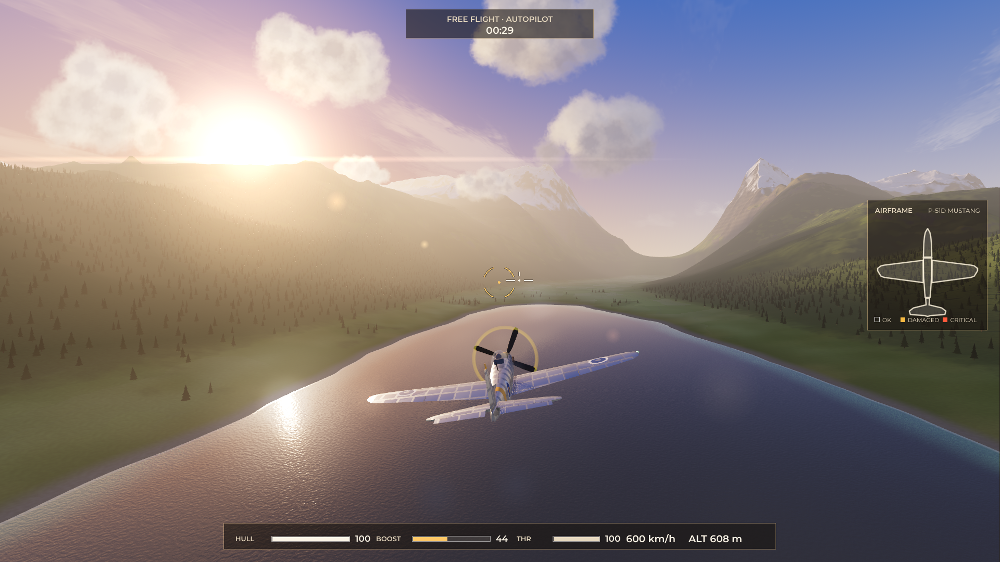
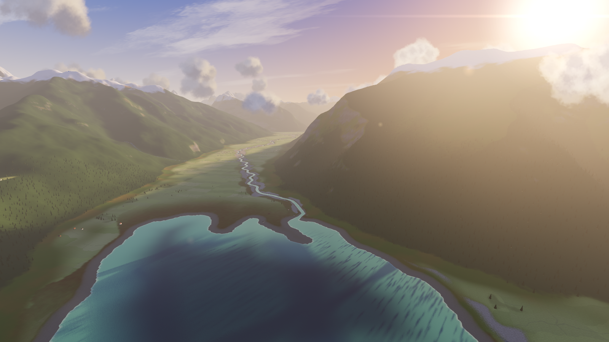

# Airflight

A 1940s arcade dogfight game for desktop, built with **Godot 4.5.1**, typed GDScript
and **Blender 5.2**. Pick a Spitfire, a Mustang or a Thunderbolt and fight AI
fighters low through an Alpine valley at golden hour: snow peaks, forested slopes,
a mountain lake, cumulus clouds and sun glare.




**Status: milestones 1-3 of 5.** Three flyable aircraft, a selection screen,
guns, damage and two AI opponents. Rockets, practice targets and multiplayer are
still to come (see [Roadmap](#roadmap)).

## The aircraft

| | Spitfire Mk IX | P-51D Mustang | P-47D Thunderbolt |
|---|---|---|---|
| Class | Light | Medium | Heavy |
| Top speed | 619 km/h (boost 738) | 583 km/h (boost 691) | 540 km/h (boost 641) |
| Agility | Best | Good | Slow to roll and pull |
| Firepower | 96 damage/s | 130 damage/s | 196 damage/s |
| Hull | 80 | 100 | 135 (and a bigger target) |
| Engine sound | Smooth Merlin V-12 purr | Rough Packard Merlin V-12 | Deep, lumpy 18-cylinder radial |
| Guns | Crisp, fast rattle | Heavy .50 cal punch | Eight-gun thump |

Real dimensions; balance is tuned for play, not history. The selection screen
appears before each sortie (and from the pause menu); hovering a card plays that
aircraft's engine.

Each aircraft has five damage zones: engine, body, left wing, right wing and tail.
A damaged engine loses power, holed wings roll slowly, a shot-up tail pitches and
yaws slowly, and a badly hit aircraft trails smoke and then fire. The airframe
panel shows where you have been hit.

Opponents fly the same flight model as you. They patrol, attack in passes, fire
short bursts, break away when hit and avoid the mountains. Each one that goes
down returns a few seconds later as the next aircraft type. Their rounds do half
damage so beginners last longer.

## Play

**Windows:** unzip `build/airflight-windows.zip` and double-click `Airflight.exe`.
No installer is needed. It requires 64-bit Windows 10/11 and a Vulkan-capable GPU
with a current driver. The Windows build is exported and its data pack was
smoke-tested under Linux, but it **has not yet been run on a Windows PC**.

**Linux:**

```sh
./run.sh
```

This runs `build/airflight-linux/airflight.x86_64` (standalone, no editor
needed). If that build is missing, it runs the project with Godot 4.5.1.

**From source (any OS):** install [Godot 4.5.1](https://godotengine.org/download/archive/4.5.1-stable/),
open `game/project.godot` and press F5.

### Controls

| Input | Action |
|---|---|
| Mouse | Move the aim circle; the aircraft banks and turns toward it |
| Left click / Space | Fire the guns |
| Shift | Boost (limited, regenerating reserve) |
| W / S | Throttle up / down |
| A / D | Manual roll |
| Q / E | Rudder |
| C | Re-centre the aim on the nose |
| Esc | Pause menu, settings and Change aircraft |
| 1 / 2 / 3, ← / →, Enter | Choose and fly an aircraft on the selection screen |
| M | Change map on the selection screen |
| F11 | Fullscreen |
| F3 | Frame-rate readout |
| F4 | Snow showers on / off (weather test) |

The small white cross shows where the nose and guns point; the amber circle is
where you are steering. Opponents are marked with orange brackets, their range
and hull; within 1 km a small orange ring shows where to aim so the rounds meet
them. Off-screen opponents get an arrow at the screen edge. If you leave the mouse alone, assisted levelling eases the aim back to
the horizon. The aircraft is lost on contact with the ground, the lake or
treetops, and respawns after three seconds.

### Maps

The selection screen has a **Map** button (or press M). The choice is remembered.

- **Alpine Valley** (default): a fictional glacial valley with a lake, peaks to 4000 m.
- **Plav & Gusinje**: the real valley in the Prokletije mountains of Montenegro,
  24 km across, built from surveyed elevation data. Plav lake has its real outline
  and lies at 0 m; the Ljuča river winds into it from Gusinje and the Lim leaves
  it northward; the Grnčar, Grebaje and Ropojana valleys branch off toward the
  high peaks in the south. Heights are measured from the lake (really at 902 m)
  and stretched 1.54 times so the mountains look bigger: the highest summit on
  the map, the Kolata massif on the Albanian border, stands 2450 m above the
  lake, and snow lies from 1500 m. Towns and villages are in their real places.




### Settings (Esc)

Mouse sensitivity, inverted vertical mouse, assisted levelling, camera shake,
volume, graphics quality (Low / Medium / High) and fullscreen. Settings and the
last aircraft flown are saved to Godot's user folder (`settings.cfg`).

**Weather test:** the day is clear, with a few local snow showers: sunlit veils
of falling snow with low visibility inside and a light dusting of fresh snow on
the ground and trees beneath them. One sits in the valley ahead of the start.
F4 or the "Snow showers" setting turns them off and on for comparison
(`--weather=0|1` on the command line).

## Performance

Measured with the built-in benchmark: 30 s of scripted low flight down the
valley, 1920×1080, vsync off, release export.

| Preset | Average FPS | 1% low FPS |
|---|---|---|
| High | 121.9 | 93.3 |
| Medium | 148.5 | 116.0 |
| Low | 318.0 | 212.3 |

These figures were measured for milestone 1. With combat added, a back-to-back
run of the same High benchmark against the milestone-1 code measured 117.3 vs
116.1 FPS, so free flight did not get slower. A fight with two opponents costs
more (about 100-150 FPS on High in the AI demo); that has not been benchmarked
on its own yet.

Test machine: Fedora Linux 44, AMD Ryzen 7 3700X (8 cores), NVIDIA GeForce RTX
2070 SUPER 8 GB (driver 615.71), 46 GB RAM, Vulkan, Godot 4.5.1. Raw results are
in `docs/benchmarks/`. To reproduce:

```sh
./run.sh --resolution 1920x1080 --disable-vsync -- --benchmark=30 --quality=2
```

The presets differ in terrain detail distance, tree draw distance and shadows,
shadow distance, screen-space reflections and ambient occlusion, MSAA, cloud
count and render scale (Low renders at 80% with FSR upscaling).

## How it is built

Everything is original or freely licensed; nothing is downloaded at build time
(the elevation survey for the second map is kept in the repository).

| Part | Source | Output |
|---|---|---|
| Alpine Valley heightmap, shadows, forest mask, 158k tree positions | `tools/generate_terrain.py` (Python + NumPy/SciPy) | `game/assets/terrain/alpine_*` |
| Plav & Gusinje: the same from surveyed elevations, plus gravel beds, brooks, reed beds, settlements and house positions | `source-assets/plav_dem.npz` → `tools/generate_plav.py` | `game/assets/terrain/plav_*`, `docs/plav_preview.png`, `docs/plav_layers.png` |
| Spitfire Mk IX, P-51D Mustang, P-47D Thunderbolt (moving prop, ailerons, elevators, rudder; fictional markings) | `tools/build_aircraft.py` → `source-assets/{spitfire,mustang,thunderbolt}.blend` | `game/assets/models/*.glb` |
| Conifers | `tools/build_trees.py` → `source-assets/trees.blend` | `game/assets/models/trees.glb` |
| Three engine sounds, three gun sounds, hits, explosion, wind (synthesised) | `tools/generate_audio.py` | `game/assets/audio/` |
| Packages for Linux and Windows | `tools/build_release.sh` | `build/` |

Rebuild steps:

```sh
python3 tools/generate_terrain.py
python3 tools/generate_plav.py
blender --background --factory-startup --python tools/build_aircraft.py
blender --background --factory-startup --python tools/build_trees.py
python3 tools/generate_audio.py
tools/build_release.sh
```

**Plav & Gusinje is built in layers** (see the top of `tools/generate_plav.py`),
so each can be refined on its own. `docs/plav_layers.png` shows them side by side.

1. **Elevation:** the SRTM survey at about 28 m per pixel, kept in
   `source-assets/plav_dem.npz`. It was fetched once with
   `tools/fetch_plav_dem.py` (20 tiles, 2.7 MB, from the open Terrain Tiles
   dataset; credits in `licenses/TERRAIN-DATA.txt`).
2. **Lake:** the level water surface found in the survey.
3. **Drainage:** where water gathers on the surveyed ground. The Ljuča below
   Gusinje and the Lim carry real water; every other stream is a painted brook,
   with a gravel bed once its catchment is large enough.
4. **Settlements:** traced from a satellite screenshot and tied to the survey by
   the lake.
5. **Rules:** forest (altitude, slope, which way a slope faces), reed beds, hay
   meadows and snow.

Three things are not as surveyed. The game has one level water surface, so
ground within a few tens of metres above the lake is levelled out (the real
floor climbs 20 m from the lake to Gusinje) and ground below the lake, down the
Lim, is raised to it. The survey smooths sharp summits, so the needle peaks are
lower and rounder than in life. Detail finer than 28 m is added noise.

A map is a set of files `game/assets/terrain/<id>_*` plus an entry in
`TerrainData.MAPS`; its `meta.json` carries the lake level, sun, start position,
route for the AI, snow shower sites and the look (snow line, colours).

The release script also runs the headless flight tests in
`game/tests/test_flight.gd`. They cover terrain sampling, turning, climbing,
levelling, boost, collision, class balance, mouse/invert handling, fire rates,
hits and misses, time to kill per aircraft, damage zones and their effects, and
AI pilots hunting for three minutes without crashing. The Plav & Gusinje map is
checked too: lake level, summit height and place, the route, the autopilot flying
it end to end and AI pilots hunting over it without crashing.

For an unattended demo, `--ai-player` lets an AI fly and fight for you, and
`--aircraft=0|1|2` skips the selection screen:

```sh
./run.sh -- --aircraft=2 --ai-player
```

`--map=alpine|plav` picks the map, and `--view=X,Y,Z,YAW,PITCH` (with
`--autopilot --no-hud --screenshot=...`) takes a picture from a fixed camera.

### Code layout (`game/scripts/`)

- `world/`: terrain data and LOD tiles, atmosphere (sky, sun, haze, post), clouds, weather (snow showers), forest, village houses, effects
- `aircraft/`: aircraft data and balance, flight model (fixed-step, network-ready), aircraft visuals, player audio, autopilot
- `combat/`: bullets and tracers, combatants (player and AI alike), AI pilot
- `input/`: `FlightCommand`, the device-independent pilot intent, and the mouse/keyboard source
- `camera/`: chase camera with boost pull-back and adjustable shake
- `ui/`: aircraft selection, HUD with target markers and the see-through airframe damage panel, lens flare, pause menu

Flight runs on a fixed 60 Hz step and is rendered with physics interpolation. All
pilot input goes through `FlightCommand`, so gamepad, touch, AI or network input
can be added without changing the flight code.

## Roadmap

1. **Flyable scene (done):** valley, lighting, clouds, forests, lake, Mustang, flight model, chase camera, HUD, settings, audio, Linux/Windows builds, benchmark.
2. **Combat (mostly done):** guns with tracers, muzzle flash, hit sparks and sounds, hit confirmation, a lead ring as aim help, damage zones driving the airframe panel and smoke and fire trails, AI fighters that pursue, evade and explode. Still to do: limited rockets and static practice targets.
3. **Aircraft choice (done):** Spitfire Mk IX, P-51D Mustang and P-47D Thunderbolt, each with its own engine and gun sound, and a selection screen before every sortie. Host Match / Join Match entries come with milestone 4.
4. **1v1 multiplayer:** host/join with a pasted invite over one host-opened UDP port, server-authoritative damage and score, smooth remote aircraft, respawn and rematch. Team data is organised so 2v2 and 4v4 can follow. Design: [docs/multiplayer-design.md](docs/multiplayer-design.md).
5. **Release check:** run natively on Windows, cross-play between Windows and Linux, and a final performance pass.

Phones (Android/iOS) would be a later project. They need touch controls, a lighter graphics tier and a relay server for online play.

## Licence

MIT (see `LICENSE`). Godot Engine is MIT (`licenses/`). The Montserrat font is
under the SIL Open Font License (`game/assets/fonts/LICENSE.txt`).
