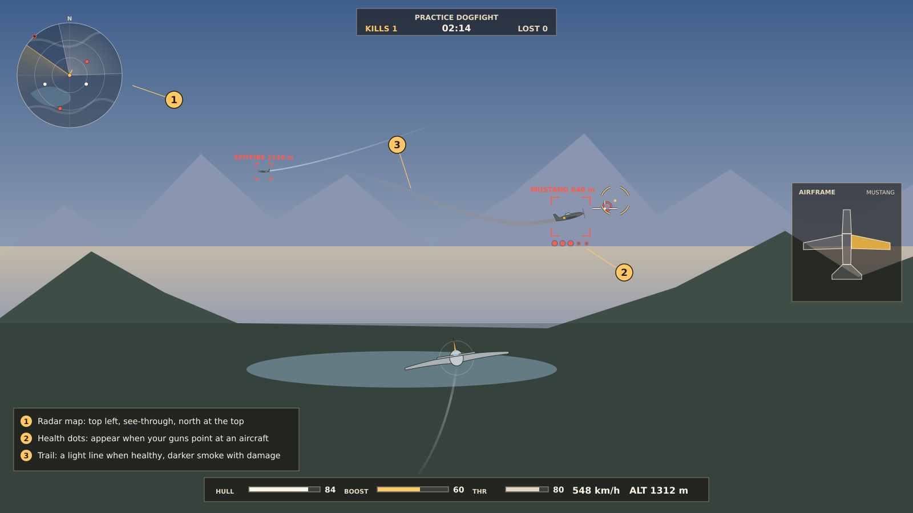
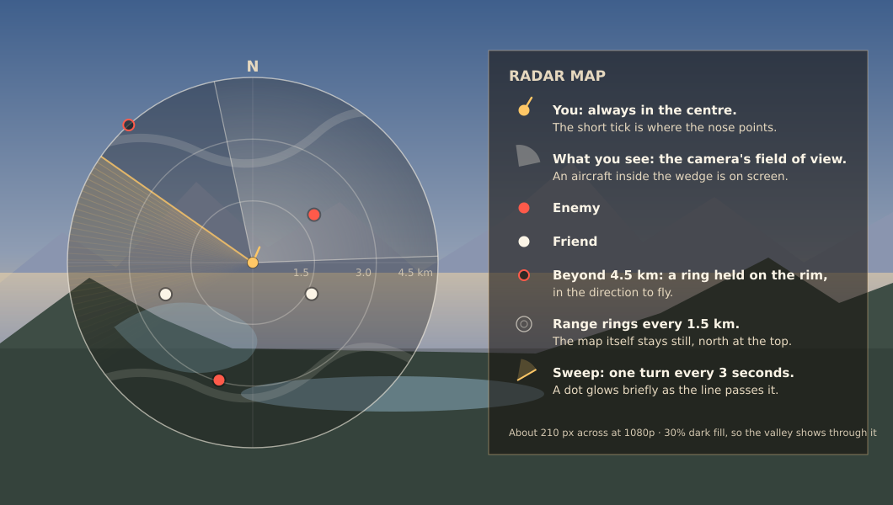
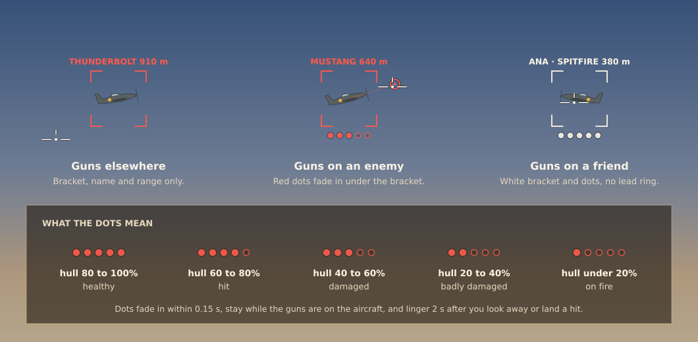
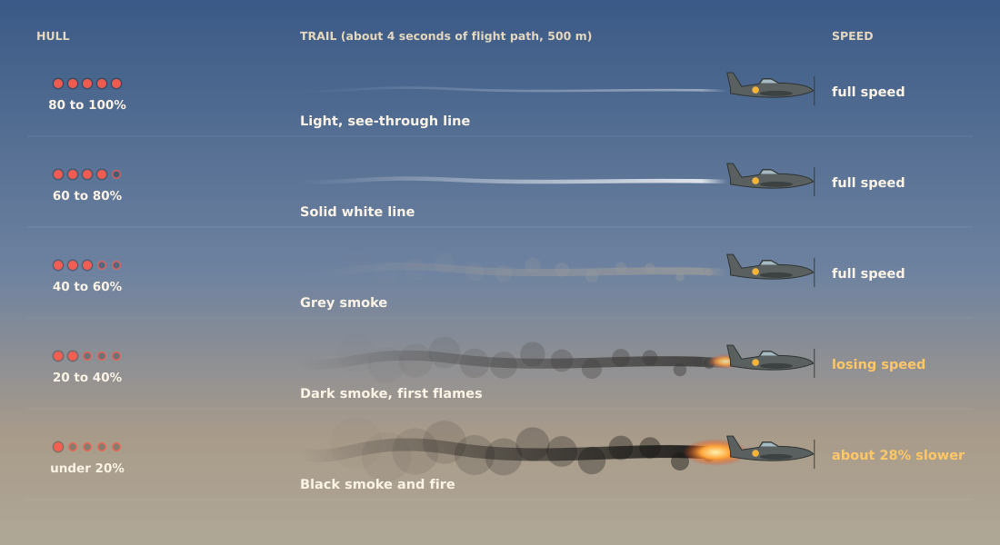
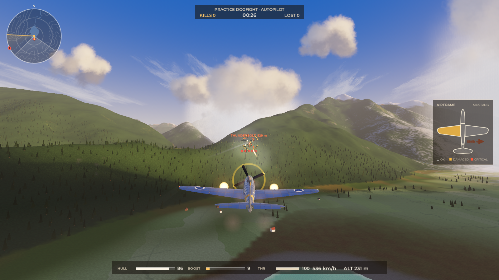

# Combat readability: radar map, health dots, damage trails

Status: **built** (12 November 2026). See "As built" at the end for what
differs from the sketches.

Three additions that make a dogfight easier to read: where everyone is, how
hurt the aircraft in front of the guns is, and which way it is flying.

The sketches are drawings, not screenshots. They show layout, colours and
behaviour; the real thing is drawn by the game in its own style.

## 1. Radar map

A round, see-through map in the top left corner. It answers "where is
everyone, and am I looking at them?" without covering the valley.

| Part | Behaviour |
| --- | --- |
| You | Amber dot, always in the centre. A short tick shows where the nose points. |
| View wedge | The camera's real field of view. An aircraft inside the wedge is on screen. |
| Enemies | Red dots. |
| Friends | White dots. |
| Out of range | Beyond 4.5 km the dot becomes a ring held on the rim, in the direction to fly. |
| Range rings | Three rings, 1.5 km apart. |
| Sweep | A line turning once every 3 seconds with a fading tail. A dot glows briefly as it passes. It is decoration: positions are always live. |
| Ground | A very faint outline of the lake and ridges under the rings, for orientation. |
| Orientation | North at the top. The map stays still; the wedge and the nose tick turn. |
| Size and look | About 210 px across at 1080p, scaling with the rest of the HUD. Dark fill at 30%, thin cream lines, no frame. |

Top left is the only corner free today: the score bar is top centre, the
airframe panel is middle right, the status strip is bottom centre and the
key hints sit bottom left for the first seconds of a sortie.

## 2. Health dots on the aircraft in front of the guns

Five dots under the target bracket show how much hull an aircraft has left.
They appear only when the guns point at it, so the sky stays clean.

- **When they show:** the gun cross or the aim circle is on the aircraft or on
  its lead ring. They fade in within 0.15 s and linger for 2 s after you look
  away or land a hit.
- **Colour:** red for an enemy, white for a friend, at about 90% opacity with a
  soft shadow so they read against snow and sky.
- **Meaning:** each dot is a fifth of the hull. Lost dots stay as thin rings, so
  the row always has the same width.
- **Replaces:** the thin hull bar that is drawn under every opponent all the
  time today.
- Friends get a white bracket and no lead ring.

## 3. Damage trails

Every aircraft leaves a line behind it that traces about four seconds of its
flight path (roughly 500 m). The line shows how it is turning, and its colour
shows how hurt it is. The stages match the health dots one for one.

| Dots | Hull | Trail | Speed |
| --- | --- | --- | --- |
| 5 | 80 to 100% | Light, see-through line | Full |
| 4 | 60 to 80% | Solid white line | Full |
| 3 | 40 to 60% | Grey smoke | Full |
| 2 | 20 to 40% | Dark smoke, first flames | Falling, gradually |
| 1 | under 20% | Black smoke and fire | About 28% slower |

- The line keeps a minimum width on screen, so a healthy enemy 2 km away
  still shows a visible trace.
- It changes smoothly between stages; there is no sudden jump in colour.
- It fades in just behind the tail, so your own trail does not cover your
  aircraft from the chase camera. You see it curve away in turns.
- When an aircraft explodes, its trail stays and fades out by itself.
- **Slowdown:** below 40% hull the engine loses power steadily, reaching about
  28% lower top speed under 20% hull. It applies to every aircraft, yours
  included, so a burning player can also be caught.

## What exists today and what changes

| Area | Today | Change |
| --- | --- | --- |
| `game/scripts/ui/hud.gd` | Brackets, range, lead ring and an always-on hull bar per opponent. No map. | Add the radar map. Swap the hull bar for the five dots. Colour by team (red or white). |
| `game/scripts/aircraft/aircraft.gd` | Puffs of smoke below 62% hull, flames below 28%. Thin wingtip ribbons only in hard pulls or at high speed. | Add one trail ribbon per aircraft, coloured by hull. Line up smoke and flame thresholds with the table above. Make the fire visible from far away. |
| `game/scripts/aircraft/flight_model.gd` | A shot-up engine zone already costs up to 29% of top speed. Overall hull damage costs nothing. | Add the hull-based power loss. Use the stronger of the two effects, never both, so the worst case stays near 29%. |
| `game/scripts/main.gd` | Clears effects on respawn. | Also clear trails when returning to the hangar or lobby. |
| Tests | `game/tests/test_flight.gd` covers engine damage. | Add checks for the hull slowdown, the dot count and the map position of a contact. |

Online play needs no new messages: each game already knows every aircraft's
hull from the host's damage reports, and the host only checks that nobody
flies faster than their aircraft can.

## Friends

The game has no friendly aircraft yet: practice opponents are all enemies and
online matches are free-for-all. The map and the dots choose red or white
from the aircraft's team, so white appears as soon as teammates exist.
Wingmen or a team mode would be a separate piece of work.

## Choices made, and the alternatives

1. **Map north-up** rather than turning with the aircraft. A fixed map lets the
   view wedge show where you are looking. The alternative, nose always at the
   top, makes "enemy on my left" more direct but leaves the wedge almost fixed.
2. **Map in the top left.** Bottom left is possible if the key hints move.
3. **Slowdown for everyone**, the player included, so online play stays fair.
4. **Dots replace the hull bar** rather than adding to it.

## Build order

1. Trails and slowdown. This is the largest gain for aiming and the only part
   that changes how the game plays.
2. Health dots.
3. Radar map.

Each step is finished with the headless flight tests and an autopilot
screenshot before the next begins.

## As built

All three parts are in the game, in the planned order. Code:
`game/scripts/aircraft/damage_trail.gd` (the trail), `game/scripts/ui/radar.gd`
and `game/shaders/radar_map.gdshader` (the map), `Hud._draw_targets` (the dots)
and `FlightModel.damage_power` (the slowdown).

Differences from the plan, found while playing it:

- **One target at a time gets dots.** When several aircraft overlap far away,
  only the one nearest the gun cross or aim circle shows them.
- **Trails fade near the camera.** A line trailing straight behind your own
  aircraft passes beside the chase camera and showed as a broad band across the
  screen. Both this trail and the existing wingtip vapour now fade out within
  30 m of the camera, so your own line shows only where it curves away in turns.
- **Your own line is fainter** (60%) than other aircraft's.
- **Fire glow.** Burning aircraft carry a soft orange glow that keeps a few
  pixels on screen at any range; it is easy to spot at 2.5 km.
- **Engine smoke follows the same stages:** light grey puffs from 60% hull,
  darkening to black; flames from 40%, growing as the hull drops.
- **Radar fill** is 36% dark rather than 30%, so the rings stay readable over
  bright cloud. The ground under it shows the lake and 300 m height contours.
- **Diagnostics:** `--opponent-hull=A,B,...` starts opponents pre-damaged, for
  checking each stage in the real game.

Measured: about 180 FPS on the test machine (1600 × 900, High) in a fight with
three trailing opponents. The headless flight tests check the slowdown (15% hull
flies at 74% of full speed, 45% hull at full speed), the trail stages, the dot
counts and radar placement.
