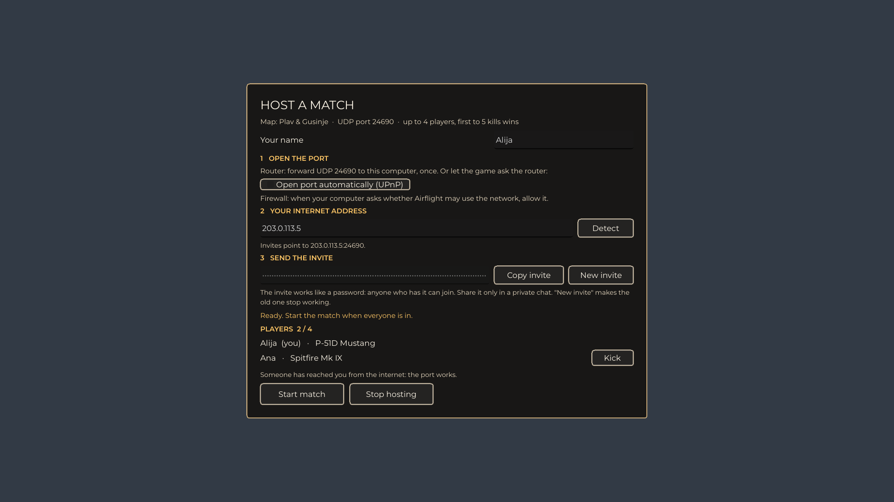
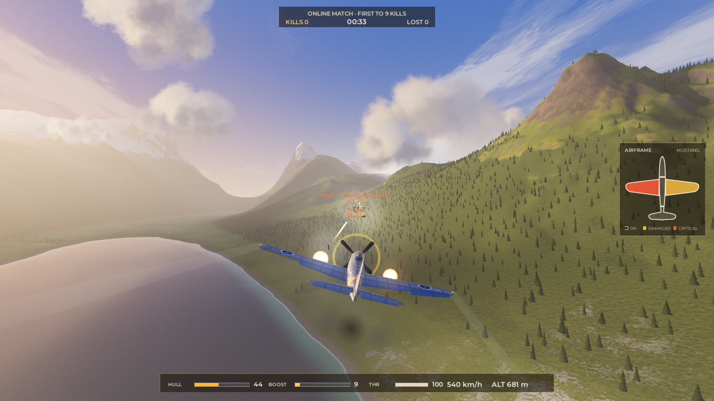
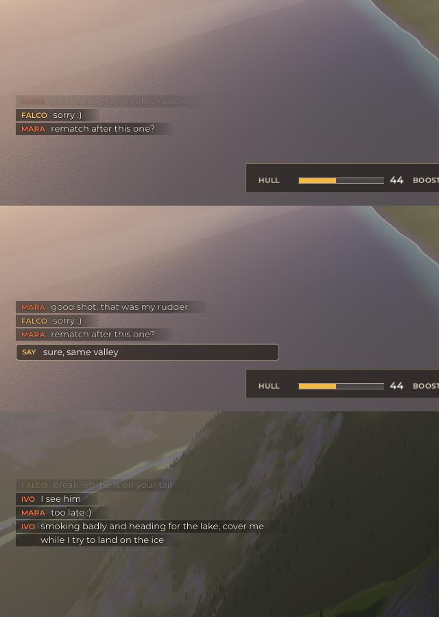

# Multiplayer design: one host-opened UDP port

**Status:** built (2026-11-12). Connection, security, lobby, gameplay netcode,
port help and the dedicated server are in `game/scripts/net/` and
`game/scripts/ui/lobby.gd`. They are tested headless and in two-process matches
over loopback (see [Test evidence](#test-evidence)). Still unproven: a match
between two homes over the internet, Windows against Linux, and UPnP on a real
router. [How it was built](#how-it-was-built) lists where the code differs from
the plan below.

## Verdict

The method is sound and is the right choice for this game. One player (the host)
opens one UDP port. Everyone else connects out to it and installs nothing. The
game encrypts the connection itself with DTLS, which Godot ships built in, so
there is no VPN.

The earlier proposal needs four corrections and has three gaps.

Corrections:

1. **Strangers can complete the encrypted handshake.** The proposal said they
   could not. DTLS here only proves the host's identity to the joiner; it does not
   check who is joining. The invite secret, checked straight after the handshake,
   is what keeps strangers out. That check has to be the first thing that happens
   and nothing else may run before it passes.
2. **A fingerprint needs two connections.** Godot has no way to read the
   certificate a host presented, so one connection cannot compare it with a
   fingerprint. Until 2026-11-14 the invite therefore carried the host's whole
   certificate and was about 1,100 characters long. Since then the invite
   carries a 16-byte hash of the certificate: the joiner first fetches the
   certificate on a connection it does not trust, checks it against the hash,
   and reconnects trusting exactly that certificate. The invite is about 70
   characters. See [The invite](#the-invite) for the reasoning.
3. **Challenge-response is not needed.** Once the joiner has verified the host's
   certificate, the tunnel is private and ends at the real host, so the secret can
   be sent through it directly. This removes a protocol step without losing
   protection.
4. **Use Godot's built-in authentication phase.** `SceneMultiplayer` can hold a
   new connection in a "pending" state where it cannot reach any game code until
   the host approves it. This replaces a hand-written gate. The Accept / Refuse
   popup becomes a lobby list with a Kick button, which does the same job without
   interrupting the host.

Gaps:

- How the host's game learns its own public address to put in the invite.
- The host's own computer firewall, which is separate from the router.
- The gameplay netcode (who decides position, hits and damage). That is most of
  the work in milestone 4, and the security design does not cover it.

For "another server", a dedicated copy of the game on a small rented server is a
better fallback than a packet relay. See
[When nobody can open a port](#when-nobody-can-open-a-port).

## Goals

- Friends play together over the internet. Only the host changes any network
  setting, and only one.
- Joining is: paste invite, press Join.
- Nobody without the invite can join, read the traffic, or pose as the host.
- 1v1 first. Nothing in the design blocks 2v2 or 4v4.

Not goals: public matchmaking, a server browser, protection against cheating by
invited friends beyond basic sanity checks, hiding the host's IP address from the
people invited.

## How a connection works

1. The host presses **Host match**. The game creates a fresh encryption key, a
   certificate and a random 128-bit secret, starts listening on the port, and
   shows an invite with a **Copy** button.
2. The host sends the invite to friends over a private chat.
3. A friend presses **Join match**, then **Paste**. Their game reads the address,
   secret and certificate hash out of the invite.
4. **Fetch.** Their game opens a DTLS connection to the address without checking
   who answered, sends one byte asking for the certificate and nothing else. The
   host answers with its certificate. The joiner accepts those bytes only if
   their size is in range and their hash equals the one in the invite, and
   parses them only after that. No match ends the join; there is no fallback.
5. **Join.** Their game closes that connection and opens a second one that
   succeeds only if the other end holds the private key of exactly that
   certificate. A fake or intercepting host fails at step 4 or here, before any
   secret is sent.
6. Their game sends the secret through the second connection.
7. The host compares it. Wrong or missing: the connection is dropped and the
   address is counted as a failed attempt. Right: the player appears in the lobby.
8. The host starts the match from the lobby and can kick anyone listed.

When hosting stops, the game stops listening. A forwarded port then leads to
nothing.

## The invite

One text string: the prefix `AF2.` followed by URL-safe base64 of these fields.
An invite to an IPv4 address is 67 to 76 characters.

| Field | Size | Notes |
|---|---|---|
| Format version | 1 byte | Reject unknown versions with a clear message |
| Address length | 1 byte | Says how long the whole invite must be, so lost or added characters can be counted |
| Port | 2 bytes | Default 24555 |
| Host address | text | IPv4, IPv6 or a DNS name |
| Secret | 16 bytes | From `Crypto.generate_random_bytes` |
| Certificate hash | 16 bytes | First 16 bytes of the SHA-256 of the host's certificate (DER) |
| Check | 3 bytes | First 3 bytes of the SHA-256 of everything before it. Catches copying mistakes only; it is not a security feature |

Rules:

- A new key, certificate and secret are made every time hosting starts. Nothing is
  saved to disk, so there is no key file to steal and an old invite is useless.
- **New invite** in the lobby replaces the secret without disconnecting anyone
  already in.
- The decoder is strict: maximum 400 characters, exact field lengths, a correct
  check, anything else is rejected with a message. An `AF1.` invite is refused
  as coming from an older version.
- The invite is a password. The UI says so next to the Copy button.

### Why a hash is as safe as the whole certificate (decided 2026-11-14)

**Question:** can the invite be short without weakening the protection?
**Decision:** carry a 128-bit hash of the certificate and fetch the certificate
from the host. **Why:**

- The hash travels inside the invite, through the private chat, exactly as the
  whole certificate did. An attacker on the network path can replace the
  certificate the host sends but not the hash the joiner already holds, so a
  replaced certificate is refused. To pass, the attacker would need a
  certificate of their own with the same hash: a second-preimage attack on
  SHA-256 at 128 bits. Collision attacks do not apply, because the attacker
  does not choose the host's certificate.
- An attacker who relays the real certificate passes the hash check and then
  fails the second handshake, because they do not hold its private key.
- Both designs fail the same way if the attacker can alter the invite itself.
- The certificate is public: DTLS shows it to anyone who connects. Handing it
  out gives a stranger nothing new.
- An invited friend still cannot pose as the host to another friend. A version
  that signed the certificate with the invite secret (about 50 characters) was
  rejected because it would allow that.

What the joiner must get right, each with a test: the hash is taken over the
raw bytes and compared before they are parsed; a mismatch ends the join; the
secret is sent only on the second connection.

Costs: one extra handshake per join (well under a second on loopback), and
`AF1.` and `AF2.` games cannot join each other.

## Transport and encryption

ENet over DTLS, both built into Godot and included in the standard export
templates. The host side:

```gdscript
var crypto := Crypto.new()
var key := crypto.generate_rsa(2048)   # about 30-80 ms
var cert := crypto.generate_self_signed_certificate(
		key, "CN=airflight-host,O=Airflight,C=XX")
var peer := ENetMultiplayerPeer.new()
peer.create_server(port, seats + 2)    # two spare slots for joiners being checked
peer.host.dtls_server_setup(TLSOptions.server(key, cert))
```

The joining side connects twice. The fetch, which trusts nobody:

```gdscript
var peer := ENetMultiplayerPeer.new()
peer.create_client(address, port)
peer.host.dtls_client_setup("airflight-host", TLSOptions.client_unsafe())
```

Then, with `cert` built from the fetched bytes once their hash matched the
invite, the join:

```gdscript
var peer := ENetMultiplayerPeer.new()
peer.create_client(address, port)
peer.host.dtls_client_setup("airflight-host", TLSOptions.client(cert))
```

`TLSOptions.client(cert)` trusts only that one certificate. The name
`airflight-host` is fixed and must match the certificate, whatever the real
address is. `TLSOptions.client_unsafe()` is used for the fetch connection only,
in one place (`NetSession._connect_to_host`), and nothing but the one-byte
certificate request is ever sent over it.

Settings on the `SceneMultiplayer` object, on both sides:

| Setting | Value | Reason |
|---|---|---|
| `allow_object_decoding` | `false` | Decoding objects from the network can run code |
| `server_relay` | `false` | Joiners talk only to the host and never learn each other's addresses |
| `auth_timeout` | 5 s | A connection that sends no secret is dropped |
| `refuse_new_connections` | `true` when the lobby is full | No handshakes beyond the seats on offer |

The game defines **no `@rpc` methods**. All traffic is small typed byte packets
sent with `SceneMultiplayer.send_bytes` and read by one decoder that checks the
message type, the exact length and every value before anything else sees it. This
keeps the code a remote machine can reach in one small file.

## Authentication phase

Setting `auth_callback` on `SceneMultiplayer` switches on Godot's pending state. A
pending peer is not announced with `peer_connected` and cannot deliver game
packets.

- **Joiner, fetch connection:** on `peer_authenticating`, call
  `send_auth(1, [0x43])` and never `complete_auth`. The answer arrives in
  `auth_callback`; if it matches the invite the session reconnects after the
  current poll.
- **Joiner, join connection:** on `peer_authenticating`, call
  `send_auth(1, secret)` then `complete_auth(1)`. The host has already been
  proven by the certificate.
- **Host:** in `auth_callback`, a single byte `0x43` is a certificate request:
  answer with `send_auth(id, certificate)`. That connection gets nothing more;
  any further message on it is dropped. Otherwise compare the received bytes
  to the secret with `Crypto.constant_time_compare`. On a match call
  `complete_auth(id)`. Otherwise call `disconnect_peer(id)`.
- **Failed attempts:** five failures from one address and the host drops further
  connections from it for ten minutes. The 128-bit secret already makes guessing
  hopeless; this only limits wasted effort.
- **Certificate requests** are not failed attempts, because every real join
  starts with one. They are counted per address on their own: a successful join
  takes its own request back, and more than ten outstanding requests block the
  address for the same ten minutes. The certificate is sent only after the DTLS
  handshake, which includes the cookie exchange, so a forged source address
  cannot make the host send it to someone else.

After authentication the joiner sends a `hello` packet with the game's protocol
version, a player name (16 characters at most, cleaned) and the chosen aircraft.
A version mismatch gives both sides a plain message and closes the connection.

## Opening the port

The host needs three things. The Host screen shows each as a checklist line.

1. **Router:** forward UDP 24555 to the host's computer. Either by hand in the
   router settings, or with an **Open port automatically** switch that is off by
   default. The switch uses Godot's `UPNP` class on a background thread (discovery
   blocks for a couple of seconds), requests a mapping with a time limit so it
   expires if the game crashes, and removes it when hosting stops.
2. **Computer firewall:** Windows asks on first run and the host must allow it.
   Fedora Workstation's default firewall already allows ports above 1024. Other
   setups may need a rule.
3. **Public address for the invite**, tried in this order: the router's answer
   over UPnP if the switch is on; a **Detect my address** button that asks a
   public "what is my IP" service over HTTPS; typing it in. A DNS name such as a
   dynamic-DNS hostname is accepted, which keeps invites valid when the home
   address changes.

Carrier-grade NAT: if the router's WAN address differs from the detected public
address, or starts with `100.64` to `100.127`, port forwarding cannot work on that
connection. The game shows this as a warning when both addresses are known.
Someone else in the group hosts, or see the fallback below. Some of these
connections have working IPv6, which the invite format already allows.

A host cannot reliably test its own port from inside its own network. The lobby
therefore shows "Nobody has reached you yet" until the first outside connection
arrives, which is the real test.

## Gameplay netcode

This is the larger part of milestone 4. The existing code suits it: pilot intent
is already a separate `FlightCommand`, `FlightModel` is plain state advanced on a
fixed 60 Hz step, `BulletField` is plain arrays, and every aircraft is a
`Combatant` in one list.

### Who decides what

| Thing | Decided by | Why |
|---|---|---|
| An aircraft's motion | The player flying it | No input lag and no rubber-banding, which matter most in a flight game |
| Whether a round hit | The shooter's game, checked by the host | What the shooter sees is what they hit |
| Damage, hull, zones, kills, respawns, match state | The host | One source of truth for the score |
| AI aircraft | The host | They are just more combatants the host flies |

The roadmap's "server-authoritative damage and score" holds: clients never change
anyone's health. They report hits and the host decides.

The alternative is for the host to simulate every aircraft from the players'
inputs, with each client predicting its own aircraft and correcting when the host
disagrees. It resists cheating better. It was not chosen for the first version
because it is much more work, and its corrections are visible as small jolts on a
responsive flight model. `FlightModel` would support it later without a redesign.

### Messages

| Message | Delivery | Rate | Content |
|---|---|---|---|
| `state` | unreliable | 30 per second | tick, position, orientation, travel direction, speed, throttle, control deflections, flags (boosting, firing, braking). About 50 bytes |
| `hit_claim` | reliable | when it happens | target id, damage zone, number of rounds, tick |
| `damage` | reliable | when it happens | target, shooter, zone, new hull and zone health |
| `destroyed`, `spawn`, `score` | reliable | when it happens | ids, position and heading, totals |
| `hello`, `roster`, `match` | reliable | lobby and match changes | names, aircraft, teams, start, end, rematch |
| `chat` | reliable | when someone talks | sender, name and up to 80 characters. A joiner sends only the text; the host stamps the sender and relays it to everyone, the sender included, so all see the same lines. Past a burst of 4, one line per 1.5 s per joiner; extra lines are dropped |

Each client sends its own `state` to the host. The host checks it and sends every
client one combined packet per tick with everyone else's state. In 1v1 that is a
few kilobytes per second each way. In 4v4 the host uploads well under 1 Mbit/s.

### Remote aircraft

A remote aircraft's `FlightModel` is not stepped. Its position and orientation are
written from received snapshots, drawn about 100 ms in the past and blended
between the two nearest snapshots. If packets stop, the aircraft continues along
its last velocity for up to 250 ms and then holds. Control deflections and the
boosting and braking flags drive the existing visuals and sounds unchanged.

Remote gunfire is drawn locally: while a remote aircraft's `firing` flag is set,
its rounds are fired into the local `BulletField` as cosmetic rounds that cause no
damage. No per-bullet packets are sent.

### What the host checks

Every `state` packet: all numbers finite, position inside the map, speed within
the airframe's limit, movement since the last packet consistent with that speed.
A failing packet is ignored. A peer that keeps failing is kicked.

Every `hit_claim`: shooter and target alive and on different teams, the shooter's
`firing` flag set around that tick, the target within gun range of the shooter
(`BulletField.SPEED` × `LIFETIME` plus a margin), no more rounds than the gun's
rate of fire allows, zone a valid value. Damage per round comes from the host's
own `Airframes` table, never from the packet.

### Code

- `game/scripts/net/invite.gd`: invite encoding and the strict decoder.
- `game/scripts/net/net_protocol.gd`: every message, its encoder and its checked
  decoder. It is the only code that reads bytes from another machine.
- `game/scripts/net/net_session.gd`: hosting, joining, DTLS, the secret check,
  attempt counting and blocking, the lobby roster, and message delivery.
- `game/scripts/net/match_referee.gd`: the host's rules. It checks reports and
  decides damage, kills, respawns and the winner, and it never touches rendering.
- `game/scripts/net/snapshot_buffer.gd`: smoothing for remote aircraft.
- `game/scripts/net/port_mapper.gd` (UPnP on a thread) and `address_probe.gd`
  (Detect my address).
- `game/scripts/ui/lobby.gd`: the Host and Join screens.
- `main.gd`: the online match loop, next to the unchanged offline loop.
  `combatant.gd` gains owner, name, life and left fields; `bullets.gd` gains
  cosmetic rounds; `hangar.gd` gains Host match and Join match.

Single player is unchanged: it runs the old loop whenever no match is online.

## How it was built

These choices were made while building and differ from, or add to, the plan
above.

- **Free-for-all, up to 4 players.** Every player is on their own team, so 1v1
  is the two-player case. Teams for 2v2 would only change who gets which team
  number in the match start message.
- **No AI aircraft online.** Online matches are players only. The referee and
  messages would carry host-flown AI unchanged; it was left out to keep the first
  version small.
- **The host's map is used.** A joiner whose map differs reloads the scene for
  it. The session lives under the scene root, so the connection survives the
  reload, and messages that arrive during it are held until the game listens
  again.
- **Joining mid-match.** A joiner can enter the lobby during a match and flies
  in the next one.
- **Matches.** First to 5 kills by default (`score_limit` in `settings.cfg`, or
  `--score-limit`). Each life has a number, so late reports and hits from a
  previous life are ignored. After the result everyone returns to the lobby.
  Pressing Start match again is the rematch. If only one player is left, the
  match ends.
- **Esc online** opens the settings without pausing the world, because the
  others keep flying. Its middle button ends the match (host) or leaves it.
- **Each invite is one host session.** A new key, certificate and secret are
  made whenever hosting starts. New invite replaces only the secret.
- **A player is removed for repeated impossible reports.** Each bad motion
  report or hit claim adds a strike. Strikes decay at 2 per second, and passing
  40 removes the player with a message. Races, such as hitting someone who just
  died, are ignored without a strike.
- **Spawns** are about 2 km apart along the valley, facing each other. Respawns
  are about 2.2 km from the nearest opponent, facing them.
- **Engine quirks found while building.** `SceneMultiplayer` will not poll until
  it has a root path, so the session points it at an empty node of its own.
  `SceneMultiplayer.disconnect_peer` does not emit `peer_disconnected`, so the
  session does that bookkeeping itself. NUL bytes in received text make the
  engine log errors, so the decoder refuses them. Closing or replacing the
  connection inside `auth_callback` crashes the engine, so the joiner only
  notes its decision there and acts after `poll()` returns. An unverified
  DTLS client needs the engine's certificate store, which is loaded after
  `SceneTree._init`, so tests that join run from `_initialize`.

### Command line

| Option | Meaning |
|---|---|
| `--host` | Host at once (with `--aircraft`, `--name`, `--port`, `--address`) |
| `--join=INVITE` | Join at once |
| `--server` | Dedicated server with no local pilot. Use with `--headless` and `--address` |
| `--address=HOST` | The address or DNS name written into the invite |
| `--port=N` | UDP port, default 24555 |
| `--score-limit=N` | Kills that win |
| `--autostart=N` | Host: start once N players are in (server default 2) |
| `--invite-out=PATH` | Host: write the invite to a file whenever it changes |
| `--quit-after-matches=N` | Quit after N matches (tests) |
| `--say=TEXT` | Send this chat line when the first match starts (tests, demos). With `--log`, chat lines are printed as `CHAT name: text` |

## Security summary

Protected:

- Reading or altering traffic: prevented by DTLS.
- Posing as the host: prevented by the certificate hash in the invite and the
  second handshake, which only the holder of that certificate's key passes.
- Joining without the invite: prevented by the secret, checked before any game
  code is reachable.
- Guessing the secret: 128 random bits.
- A leaked invite: the host sees the stranger in the lobby and kicks them, then
  presses New invite.

Still exposed while hosting:

- The port is visible. Anyone can complete the encrypted handshake and fetch the
  certificate, and is dropped at the secret check. Each attempt costs the host a little CPU, and Godot offers
  no way to refuse an address before the handshake, so a determined flood can
  disrupt a match. It cannot get in.
- A bug in Godot's ENet or DTLS code would be reachable by strangers. Keep Godot
  current for releases.
- Invited friends learn the host's IP address. The host learns theirs. Joiners do
  not learn each other's.
- An invited friend with a modified game could fly impossibly or claim unfair
  hits, within what the host's checks allow.

Requirements, each with an automated test in `game/tests/test_net.gd`:

1. A joiner with the right invite connects.
2. A joiner whose invite names a different certificate than the host sends
   stops after the fetch, having sent only the certificate request. The same
   holds for an impostor's own certificate, oversized, truncated and random
   answers, and an impostor that relays the real certificate (it fails the
   second handshake). In none of these cases is the secret sent.
3. A joiner with a wrong secret, or who sends none, is dropped and never appears
   as a connected peer.
4. An unencrypted ENet client cannot connect.
5. Malformed, truncated and oversized packets and invites are rejected without
   errors.
6. Hit claims and state packets that break the host's checks are ignored.
7. After hosting stops, the port is closed.
8. Fetching the certificate neither lets anyone in nor counts as a failed
   attempt; more than ten fetches from one address without a join block it; a
   join takes its own fetch back.
8. `allow_object_decoding` is false and no script contains `@rpc`.

## When nobody can open a port

Run the same game without graphics on a small rented server (about €4 to €5 per
month):

```bash
./Airflight.x86_64 --headless -- --server --address=SERVER_PUBLIC_IP
```

It prints `INVITE AF2.…` (and writes it to `--invite-out` if given). It starts a
match as soon as two players are in and starts a new one six seconds after each
result. Every player connects out to it, so nobody opens a port and nobody's home
address is shared. The server skips trees and clouds. It still loads the map,
because flight collision needs the terrain.

This is better than a packet relay because it is the same host code with no local
player, rather than a second program with its own protocol. Under this design the
host only checks packets, forwards state and keeps score, so the server needs very
little power. It costs some extra delay, usually 10 to 30 ms when the server is
nearby.

It was cheap to build, because the host logic never depended on rendering. It
is the same code as a player's host with no local pilot.

## Build order

1. **Connection:** invite encode and decode, DTLS, authentication, lobby,
   `--host` and `--join` flags, `test_net.gd`. Two copies on one machine reach a
   shared lobby.
2. **Seeing each other:** `state` packets and remote aircraft smoothing, tested
   with artificial delay and packet loss.
3. **Combat:** hit claims, damage, score, respawn, rematch.
4. **Port help:** UPnP switch, address detection, carrier-grade NAT warning.
5. **Real test:** two homes over the internet, then Windows against Linux
   (roadmap milestone 5).
6. **Dedicated server:** only if needed.

Steps 1 to 4 and 6 are built. Delay and loss were tested on the smoothing code
with simulated loss and jitter, not on a real link. Step 5 needs two machines in
different homes and a Windows build, and is still to do. Until then, how the game
feels at real latency is unknown.

## Prototype evidence

Godot 4.5.1, two peers in one process on loopback, RSA-2048 self-signed
certificate.

| Check | Result |
|---|---|
| Joiner trusting the host's certificate connects | Yes |
| Certificate rebuilt from the bytes in an invite works | Yes |
| Joiner trusting a different certificate | Refused during the handshake |
| Right certificate, wrong fixed name | Refused |
| Joiner using the system's normal certificate authorities | Refused |
| Unencrypted ENet client | Cannot connect |
| Right secret in the authentication phase | Both sides connected, about 0.5 s |
| Wrong secret | Dropped; host never reports a connected peer |
| No secret sent | Dropped at the timeout; host never reports a connected peer |
| Outside client (`openssl s_client -dtls1_2`) | Completes the handshake and sees the certificate, which confirms correction 1 |
| Key generation | 30 to 80 ms |
| Certificate size, full invite length | 796 bytes, 1,103 characters with the certificate inside (until 2026-11-14), 71 with its hash |
| Methods on `PacketPeerDTLS` and `ENetPacketPeer` that return the remote certificate | None, which confirms correction 2 |
| Unverified client (`TLSOptions.client_unsafe()`) fetches the certificate in the authentication phase, then a second client trusting it connects on the same `SceneMultiplayer` (2026-11-14) | Yes, once the engine has loaded its certificate store |

## Test evidence

All on Godot 4.5.1, Linux, 2026-11-12; rerun with the short invite on 2026-11-14.

**`game/tests/test_net.gd`** (headless, about 40 s; also run by
`tools/build_release.sh`). Every check passes:

- **Invites (short format, 2026-11-14):** round trip (71 characters, at most 76
  for an IPv4 address); DNS names; paste whitespace, line breaks and invisible
  characters. It refuses empty, foreign, truncated, oversized, stray-character,
  wrong-version, previous-format, bad-address and port-0 invites, each with a
  message; counts 1 to 8 lost or added characters; and refuses one changed
  character at any position. The hash accepts the host's certificate and
  refuses another certificate, one changed bit, oversized, empty and random
  bytes.
- **Messages:** every type round-trips. Every truncation and any extra byte is
  refused. NaN, absurd speeds, non-unit rotations, bad zones, bad aircraft ids,
  invalid UTF-8 and NUL are refused. Names are cleaned. 4,000 random and damaged
  packets cause no crash. A motion report is 55 bytes.
- **Smoothing:** a straight path is drawn within 1.3 m of the truth, 100 ms
  behind. A turning path with 30 % of reports lost and up to 50 ms of jitter
  stays within centimetres, with no jumps. Without reports it extrapolates for
  at most 250 ms. Late reports are ignored.
- **Referee:** it refuses teleports, impossible speeds, positions off the map,
  clocks running ahead, hits without a trigger, hits out of range, self-hits,
  hits on a previous life and claims beyond the rate of fire. Damage uses the
  host's figures. A respawn comes after 3 s with a new life. Kills and losses
  count. The score limit ends the match, and no damage counts after it. Crashes
  count once. A match left with one player ends. Repeated bad reports mark the
  player for removal.
- **Live loopback connections:** these exercise the security requirements
  above. The right invite reaches the lobby with name and aircraft, and messages
  flow both ways. A joiner's host-only messages are dropped. Kick removes the
  joiner with a reason. After New invite, the old invite fails. After hosting
  stops, the port is free. A host that is not the invite's is refused after the
  fetch, and impostors that answer with their own certificate, junk, or the
  relayed real certificate never receive the secret. Fetching the certificate
  alone lets nobody in and is not a failed attempt; the eleventh fetch without
  a join blocks the address; returning players are never blocked. A wrong secret, or none before the timeout, is dropped,
  never connected, and counted. Five failures block the address, even with the
  right invite, until the block expires. An unencrypted client cannot connect.
  Junk packets never reach the game, and the sender is disconnected. A different
  version is refused with a clear message. No script contains remote calls, and
  object decoding is off.
- **Chat (added 2026-11-13):** a line round-trips with its sender, is cleaned of
  control characters, cut to 80 characters, and a line of 4-byte characters is
  shortened to fit its one-byte length instead of being garbled. Empty lines are
  refused. Over loopback both players see the same lines in the same order; a
  joiner's line comes back under their own name; a joiner cannot pose as the
  host; a flood of 12 lines is cut to the burst and the sender stays connected.
  A line shows for 8 s and fades over 1 s; long lines wrap inside the box. While
  typing, held flight keys and Space do nothing and the mouse still steers and fires.

**`tools/net_smoke.sh`**: whole matches between separate headless game
processes over loopback, all pilots flown by the AI, first to 2 kills.

- Host and joiner. The joiner started on the other map and reloaded to the
  host's, keeping its connection. The match started on its own and the pilots
  found each other. Hits, hull values, kills and losses matched in both
  processes all the way through. The host won 2-1 after about 3 minutes, both
  processes showed the same result, and both quit.
- Dedicated server and two joiners: the same, with the server flying no
  aircraft and relaying the two players.
- Chat (2026-11-13): host and joiner each send a line when the match starts
  (`--say`); the script fails unless every process's log shows both lines.

**Lobby screens:** rendered off-screen with live sessions by
`game/tests/render_lobby.gd` and checked by eye: the host screen with the
checklist, invite and player list with Kick, the join screen, and the joined
lobby.



**In flight:** a windowed joiner against a headless host, both flown by the AI.
The joiner sees the host's Thunderbolt in the target bracket under the host's
name, and the damage the host decided on its own airframe panel.



**Chat:** drawn by `game/tests/render_chat.gd` over game screenshots at
1600×900: three lines with the oldest fading, the open chat line with recent
lines shown again, and a long line wrapped over two rows.



Not tested:

- **UPnP on a real router.** Doing so would change the router's settings. The
  code follows Godot's API, and a refusal or no router falls back to manual
  forwarding with a message.
- **Detect my address.** Running it would send this machine's address to an
  outside service.
- **Two homes over the internet, and Windows against Linux.**
- **Playing it by hand with mouse and keyboard.** Every match above was flown
  by the AI.

## Open points

- Godot 4.5.1 prints `Parameter "p_mutex->mutex" is null` three times whenever a
  DTLS connection closes. It does so in the real game too, and connections made
  afterwards work normally, so it is log noise from the engine. Recheck with
  newer Godot versions.
- Godot prints one "Unicode parsing error … NUL character" each time it
  generates the host's key and certificate. This also comes from the engine and
  does no harm.
- `TLSOptions.client_unsafe()` worked in one prototype run and failed to start in
  another. The cause was not investigated because the design never uses it.
- UPnP was not exercised, since doing so would change real router settings.
- How shooter-decided hits feel at real latency is untested until two machines
  in different homes fly against each other.
